# LocalCord

[Русский](README.md) · **English**

Voice, chat and screen sharing for your own group — on a local network or over Radmin VPN.
Like Discord, but the server is one of your friends' computers, not someone else's data center.


<a href="https://github.com/Zubakamaraka/Localcord/releases/latest"></a>
<a href="https://github.com/Zubakamaraka/Localcord/releases/latest"></a>

One installer for everyone: download, open — and a minute later you are talking. From a phone, too.

**Download page for friends:** https://zubakamaraka.github.io/Localcord/en/

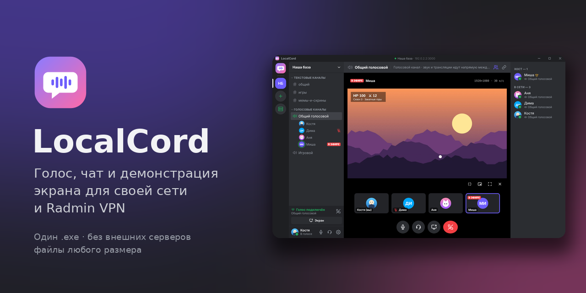

---

The project grew out of constant Discord outages, especially when talking to friends in Russia.
LocalCord works inside your own network: a local one or a virtual one such as
[Radmin VPN](https://www.radmin-vpn.com/). No accounts, no external servers, nothing to block —
messages and files are stored on the host's computer, and voice and video go directly between participants.

- **one .exe** — the host and the friends install the same app; the role is chosen in the interface
- **your profile is remembered**: name, color and photo are entered once
- **server auto-discovery** on the network — typing an address is optional
- **text channels** with history that survives restarts
- **files and images** by drag and drop, pasting (Ctrl+V) or the “+” button; large files are streamed, with no memory limits
- **voice channels**: noise and echo suppression, a “who is speaking” indicator, per-person volume, a “how do I sound” microphone test
- **screen sharing** up to 4K · 60 fps, with stereo computer audio, watched on demand via “Watch”
- **stream viewer**: full screen (F or double-click), Esc to go back, a mini window over the chat, “always on top” mode
- **one-click updates**: the app finds new versions on GitHub by itself and can go back to a previous one; offline, the host shares the update
- **optional server password**; passwords are stored encrypted on the computer
- **7 themes** (dark, light, “Midnight” for OLED), your own accent color and interface size
- **profile customization**: avatar frames, name fonts, animated GIF avatars
- **English and Russian** — in the app, the installer and on the download page
- **Android version**: chat, files, voice and watching streams from a phone

---

## What it looks like

The screenshots show the Russian interface; the app follows your system language and can be switched
in Settings → Appearance & language.

| First launch | Host or guest | Connecting |
| --- | --- | --- |
| 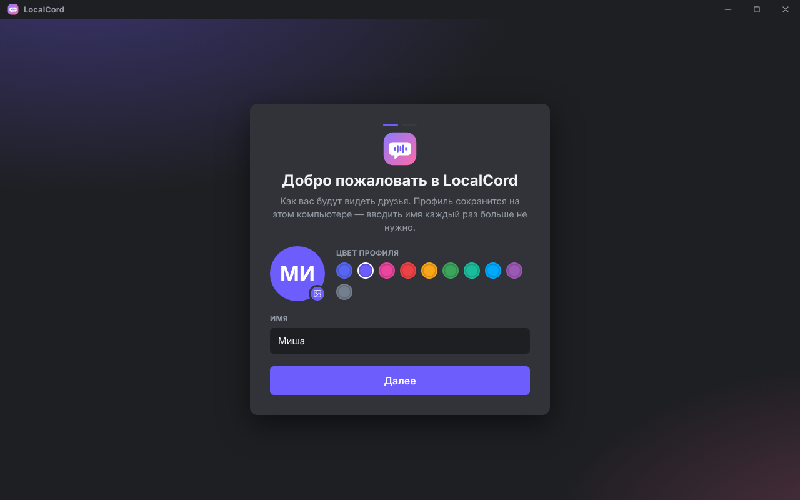 | 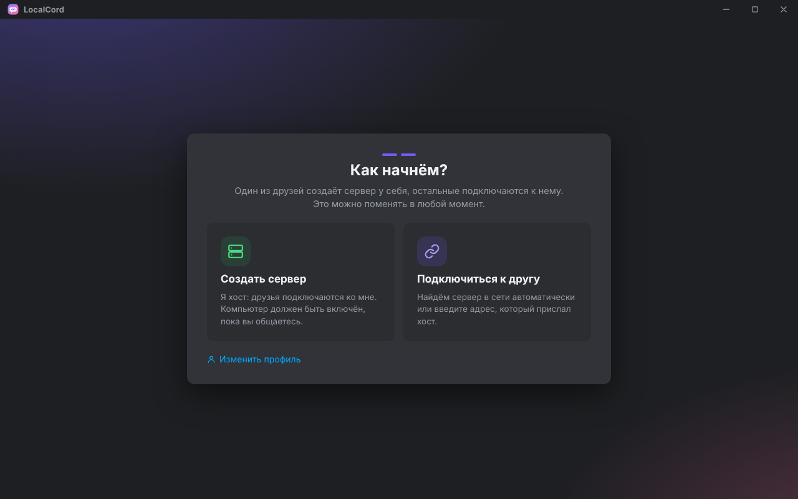 | 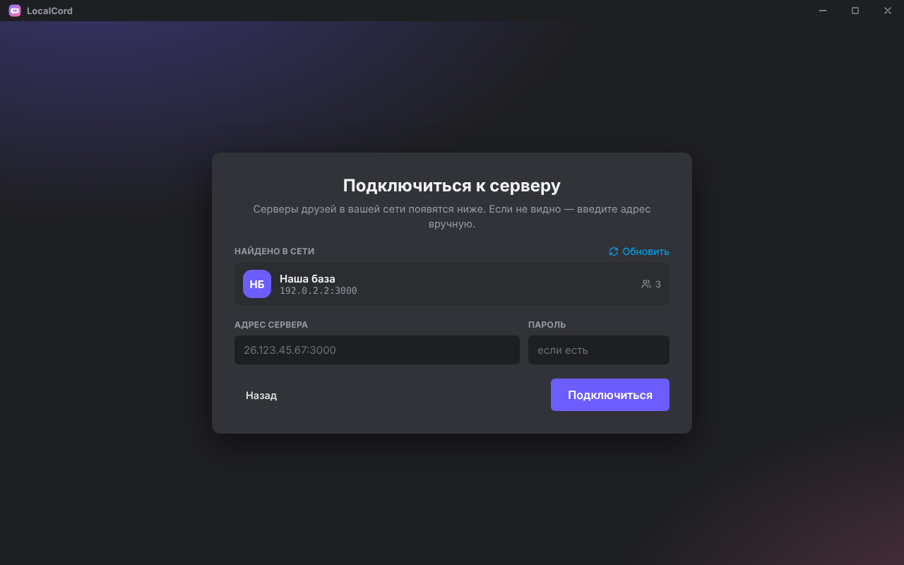 |
| Name, color and photo — once | Create a server or join one | Servers on the network are found automatically |

| Chat | Drag-and-drop files | Voice channel |
| --- | --- | --- |
| 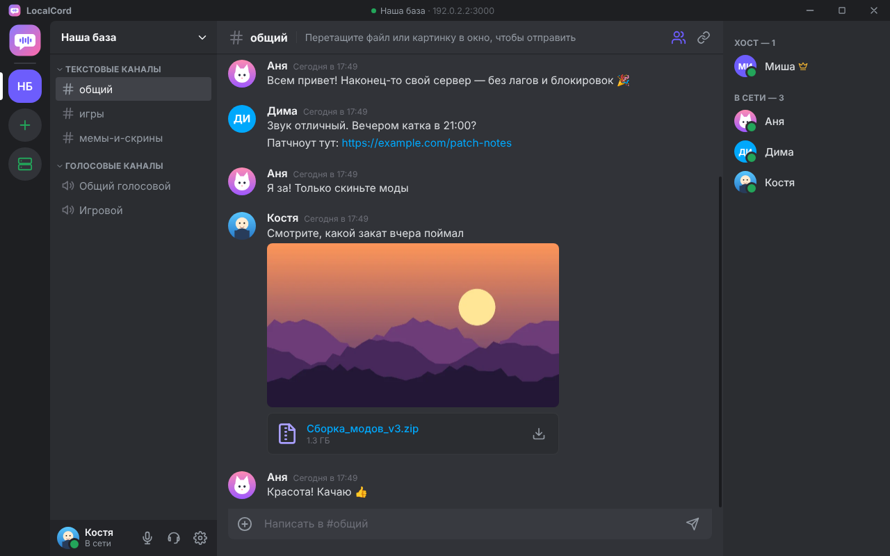 | 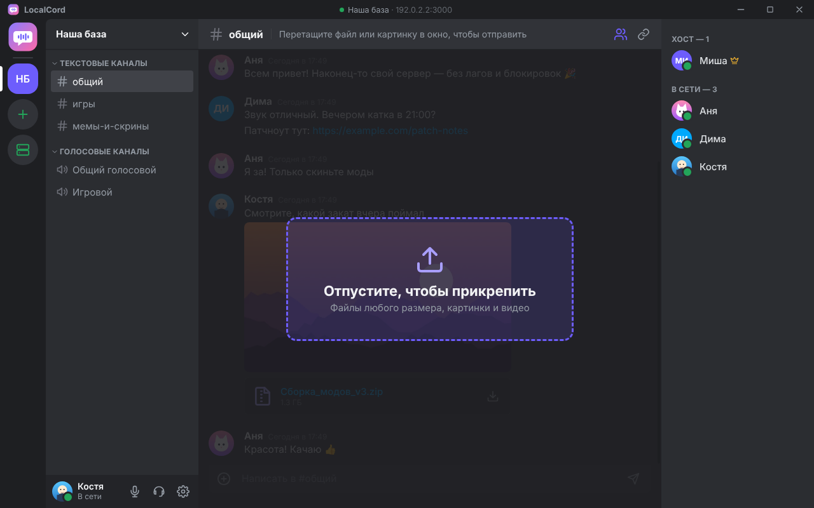 | 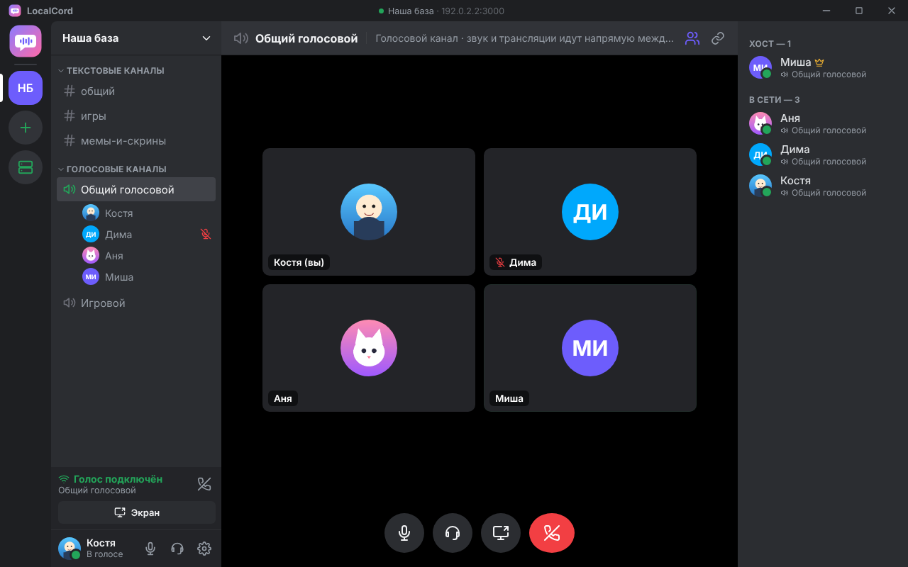 |
| Images, files, links | Any size, several at once | Whoever speaks is highlighted |

| Picking a source | Watching | Mini window |
| --- | --- | --- |
| 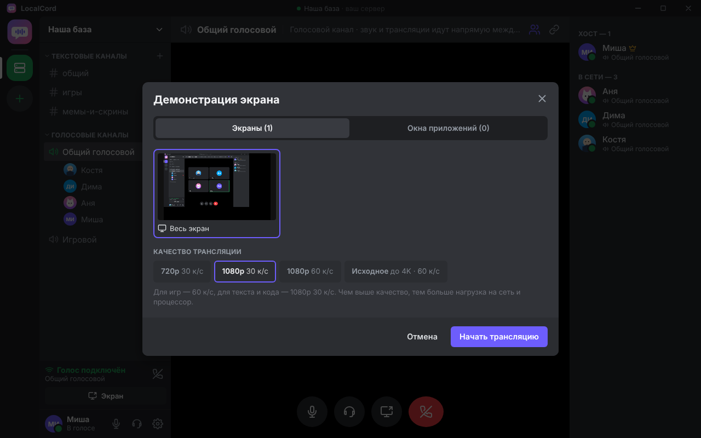 | 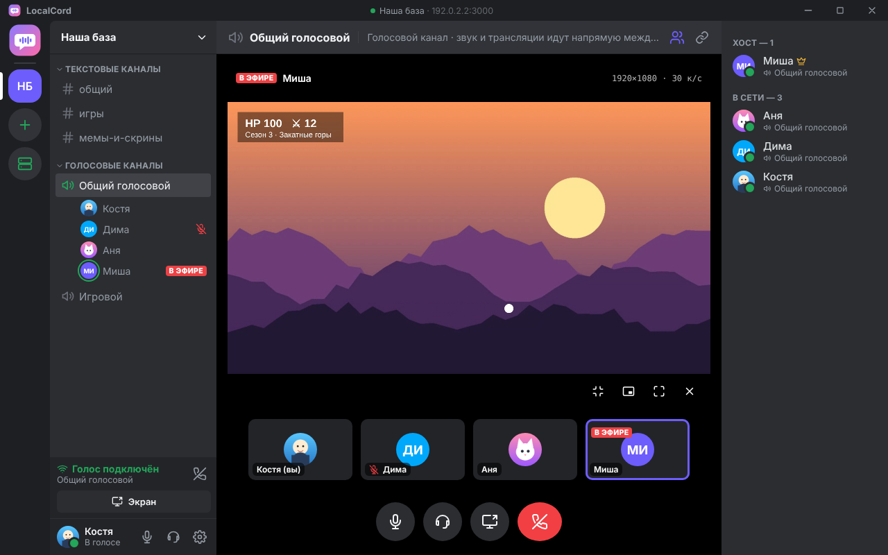 | 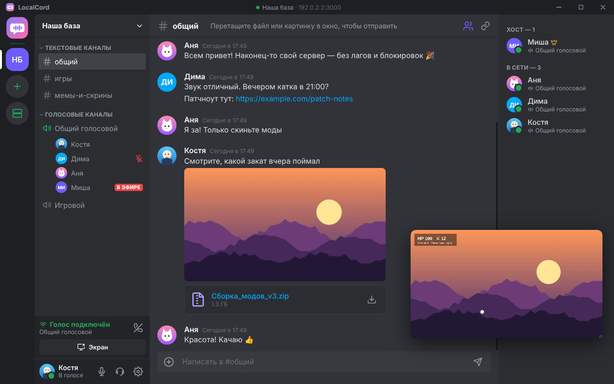 |
| Screen or window, quality, audio | 1080p, full screen with F | Watch and chat at the same time |

| Live | Invite friends | Server settings |
| --- | --- | --- |
| 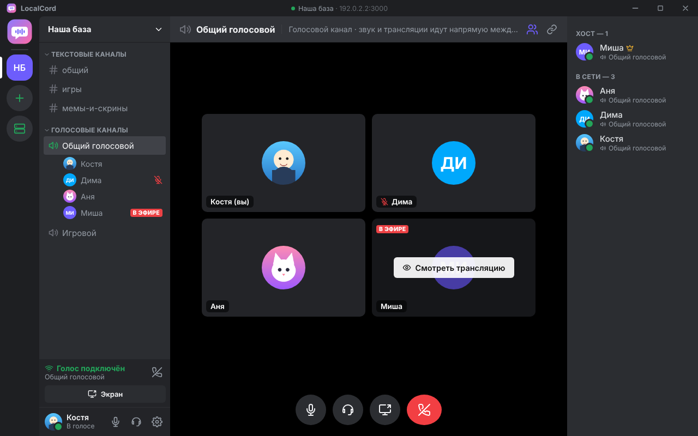 | 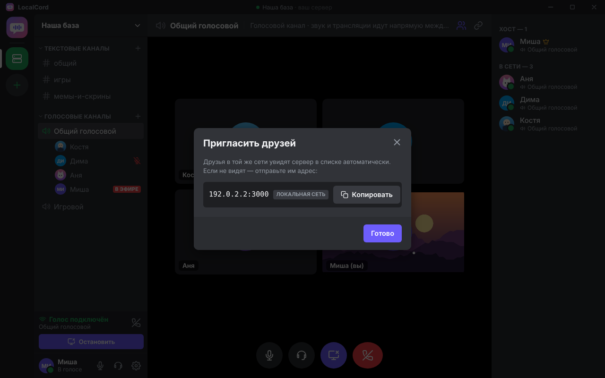 | 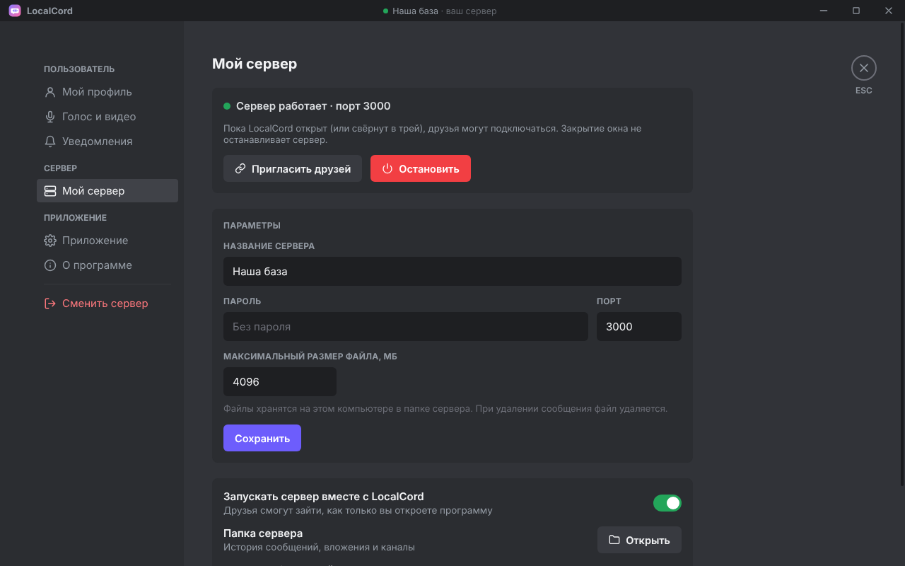 |
| Only those who clicked are watching | Addresses with a “Copy” button | Password, port, file limit |

### Themes

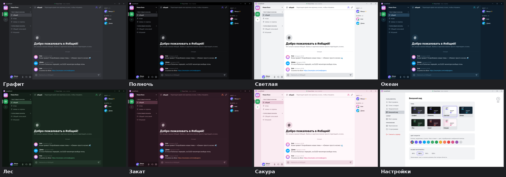

Settings → “Appearance & language”: Graphite (like Discord), Midnight (black, for OLED), Light, Ocean, Forest,
Sunset, Sakura. Any accent color — preset or your own — and an interface size from 90 to 125 %.
The language is switched there as well: English, Russian or “same as system”.

### Profile customization

Settings → “My profile”: nine avatar frames (from the calm “Accent” to the animated “Galaxy” and “Rainbow”),
eight name fonts and a photo or a GIF. An animated GIF stays animated — LocalCord crops it to a square and
shrinks it to avatar size by itself. Frames and fonts are visible to everyone running version 2.2 or newer;
for the others your profile simply looks plain.

### On a phone

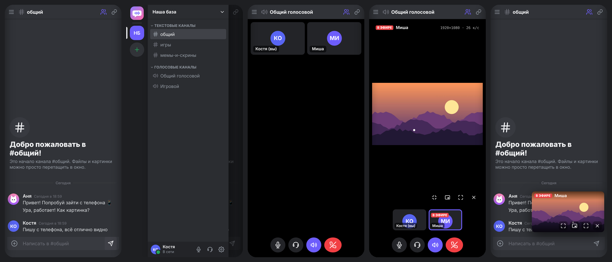

Chat, the channel drawer (swipe from the left edge), a voice channel, watching a stream and the mini window over the chat.

---

## Requirements

|              |                                                                         |
| ------------ | ----------------------------------------------------------------------- |
| System       | Windows 10 or 11, 64-bit; phone — Android 7 or newer                     |
| Network      | a shared local network or [Radmin VPN](https://www.radmin-vpn.com/) (Hamachi, ZeroTier and the like work too) |
| Internet     | not required — only a network shared with your friends (updates from GitHub need it) |
| Disk space   | about 450 MB                                                            |
| Host         | the computer has to stay on while you talk                              |

---

## Installation

1. Download **`LocalCord-Setup-x.y.z.exe`** from the
   [releases](https://github.com/Zubakamaraka/Localcord/releases/latest) page (or get the file from a friend).
2. Run it. Installation takes a few seconds and needs no administrator rights — like Discord.
   LocalCord appears on the desktop and in the Start menu. The installer is in English on any
   non-Russian Windows.
3. On first launch enter your name, pick a color and, if you like, a photo.

> Windows may show a SmartScreen “Unknown publisher” warning — the installer is not signed with a
> paid certificate. Click “More info” → “Run anyway”.

### If you are the host (the server is yours)

1. “Create a server” → a name, optionally a password → “Start server”.
2. LocalCord shows the addresses for your friends (the Radmin VPN address is marked green) — click “Copy” and send it.
3. Click **“Allow”** in the firewall box: Windows asks for administrator rights once.
   Without it friends on Radmin VPN may fail to connect — Windows treats the Radmin network as “public”.
4. Closing the window does not stop the server: LocalCord minimizes to the tray. To quit, right-click the tray icon.

Server management lives in “Settings → My server”, or right-click the green server icon on the left:

- **name, password and file limit** change on the fly, nobody is kicked; changing the port restarts the server;
- **stop the server** — friends are disconnected, channels and history stay, the server can be started again;
- **delete the server** — erases channels, history and files (you have to type a confirmation word);
- as the owner you do not need the password: the app recognizes its own server at any address. In the
  “Found on the network” list it is shown as a single “your server” row even if the computer has several
  networks (Wi-Fi, Radmin VPN, internet sharing).

### If you are a guest

1. “Join a friend”. The host's server appears in the “Found on the network” list — click it.
2. If the list is empty, paste the address the host sent (for example `26.123.45.67:3000`) and the password, if any.
3. From then on LocalCord connects by itself on every launch.

A server you no longer need is removed with the cross in “Recent servers”,
or by right-clicking its icon on the left → “Remove from list”.

---

## Android

Download **`LocalCord-x.y.z.apk`** from the [releases](https://github.com/Zubakamaraka/Localcord/releases/latest)
page straight to the phone, open the file and allow installing from that source.

The server runs only on a computer — the phone connects to it. How the phone gets into the host's network:

| Where you are | What you need |
| --- | --- |
| At home, on the same Wi-Fi as the host | nothing: the server shows up in “Found on the network” by itself |
| Away from home | a shared VPN network that has an Android app, for example [ZeroTier](https://www.zerotier.com/) or [Tailscale](https://tailscale.com/). Radmin VPN is Windows-only |

The host can be in Radmin VPN (for friends on computers) and, say, ZeroTier (for phones) at the same time:
the server listens on all networks at once, and “Invite friends” shows all of its addresses.

What the phone can do: chat, images, videos and files (sending from the gallery and file manager, downloading
through the browser), voice channels (they keep working with the screen off — a “Voice connected” notification
stays in the shade), watching streams in full screen and in the mini window, switching audio between the speaker
and the earpiece, themes. Sharing the phone's own screen is not available yet. The Back button closes windows one by one.

---

## Screen sharing

- Click the screen icon at the bottom of a voice channel → pick a screen or a window → pick the quality.
- **720p / 1080p 30 fps** — for text, code, slides; **1080p 60 fps** — for games.
- **1440p and 4K** are heavy modes: they need a graphics card with hardware encoding (LocalCord turns it on by itself)
  and a fast network — roughly 20–35 Mbit/s of upload. If either is missing, 1080p looks better than
  a 4K stream that cannot be compressed in time.
- While you are streaming, your tile shows what viewers actually get: resolution, frames per second,
  codec and what limits the quality — the computer or the network.
- “Share computer audio” sends game or video sound in stereo, without “speech” processing.
  LocalCord asks Windows not to add its own sound (your friends' voices) to the stream. If viewers still
  hear themselves with an echo, your Windows cannot do that — turn the option off.
- The stream is sent only to those who clicked “Watch” — this saves the streamer's network and CPU.

For the viewer:

| Action | How |
| --- | --- |
| Full screen | the ⛶ button, the **F** key or a double-click |
| Exit full screen | **Esc** |
| Shrink to the mini window | the shrink button or **Esc** once more; the mini window can be moved and resized by its corner |
| Always on top | the picture-in-picture button |
| Stop watching | ✕ |

When the streamer stops, the viewer window closes by itself.

---

## Files and images

Drag files into the chat window, paste an image with Ctrl+V or click “+”.
Up to 10 files at a time; the size is limited only by the host's setting (4 GB per file by default).

- Files are streamed: even a multi-gigabyte archive is never loaded into memory as a whole.
- Large photos automatically get a smaller copy for the chat feed;
  the original opens on click and downloads with a button.
- Videos (mp4, webm) and audio play right in the chat.
- Downloads are saved to the Downloads folder.
- Files are stored on the host's computer. Delete the message — the file is deleted too.

---

## Updating

**From GitHub.** “Settings → Updates” → “Check for updates” → “Download and install”. LocalCord downloads the installer
from the releases page, verifies its checksum, installs it and starts again. Once a day the app checks for
a new version by itself and shows a “A new version is out” bar (this can be turned off on the same page).

**From the host, offline.** If the host runs a newer version, friends see an “A new version is available”
bar when they connect → “Update” → “Install and restart”.

**Going back to a previous version.** The same section lists the releases with a “Go back” button.
Versions before 2.2 have no “Updates” section: to return, use the download page.

**Android.** The button in “Updates” opens the APK download; it installs over the old one. Android does not
install an older version over a newer one — to go back, the app has to be uninstalled first.

Your profile, settings, history and files are kept through updates and rollbacks.

---

## Uninstalling

Any of these:

- Start menu → **“Uninstall LocalCord”**;
- in the app itself: Settings → “App” → “Uninstall LocalCord”
  (you can tick “also delete the profile and history” there);
- Windows Settings → Apps → LocalCord → Uninstall.

---

## Security and privacy

| What | How it is protected |
| --- | --- |
| Voice and streams | go directly between participants and are always encrypted (DTLS-SRTP, the WebRTC standard) |
| Chat and files | stored only on the host's computer; over Radmin VPN the traffic is additionally encrypted by the VPN itself |
| Joining a server | an optional password; the comparison is protected against timing attacks |
| File access | only with the member's personal key issued on join |
| Channel management | the host only |
| Passwords on the computer | encrypted with Windows facilities (DPAPI) |
| The app | an isolated interface with no system access, third-party scripts are forbidden (CSP), links open in the browser |
| Flood protection | limits on message rate and text size |

Limitations worth knowing:

- On a **plain local network without a VPN** (for example shared Wi-Fi) chat text and files travel
  unencrypted. Voice and video are always encrypted. To talk over the internet, use Radmin VPN.
- The server is reachable from **all networks** the host's computer is connected to. On a public network
  (a café, a dormitory) set a password or do not start the server.
- An update is installed only after you confirm it — accept updates only from a host you trust.
  The installer from GitHub is verified by its SHA-256 checksum and is taken only from github.com.
- Checking for updates is the only time the app talks to the internet: one request a day to GitHub for the
  list of releases. It can be turned off in “Settings → Updates”.

---

## Project layout

```
src/
  main/            Electron main process
    main.js          window, tray, firewall, embedded server, uninstall
    updater.js       updates from GitHub: release list, download with checksum verification
    i18n.js          language of tray and notification texts (lang-en.js holds the translation)
    preload.js       the safe bridge between the interface and the system
    store.js         profile and settings (settings.json)
  server/          the server — runs inside the host's app
    server.js        chat, history, files, WebRTC signaling
    discovery.js     server auto-discovery on the network (UDP)
    standalone.js    running the server without the interface
  renderer/        the interface
    index.html, styles.css
    js/              app, chat, voice, settings, theme, onboarding, net, icons, platform-android, i18n
    js/lang/en.js    English translation of the interface (the key is the Russian string from the code)
    vendor/          socket.io, gifenc and the name fonts (local, nothing is loaded from the network)
  assets/          app icons
android/           the Android app (Capacitor): a native plugin for server discovery and background voice
.github/workflows/ automatic build of the installer and the APK on GitHub
build/             icon, images and texts of the installer (NSIS, English and Russian)
test/              automated tests of the server and the interface
docs/              the download page (GitHub Pages): Russian, and en/ — English; img/ — images
```

Data on the computer lives in `%APPDATA%\LocalCord`:
`settings.json` — profile and settings, `server-data\` — history, channels and files of the server (host only).

---

## Development

You need [Node.js](https://nodejs.org) 20+.

```bash
npm install
npm start               # run the app
npm test                # server tests + a check that every UI string is translated
npm run test:e2e        # real LocalCord windows: chat, voice, streaming, own server, password, language, updates
npm run dist            # build the installer into dist/
```

Two clients on one computer for testing:
`set "LOCALCORD_PROFILE=%TEMP%\lc2" && npm start` — a second window with its own profile.

The server without the interface (for example on an always-on machine):
`npm run server -- --port 3000 --name "Our base" --password 123`.

Source strings are written in Russian inside `t('…')`; the English text goes to `src/renderer/js/lang/en.js`.
`npm test` fails until every string has a translation. Code comments are in Russian.

### Releasing a new version

1. Change `version` in `package.json` (for example `2.2.1`) and push to GitHub.
2. The **Actions** tab → “Сборка релиза” (release build) → **Run workflow**.
3. In 10–15 minutes `LocalCord-Setup-x.y.z.exe` and `LocalCord-x.y.z.apk` appear on the Releases page.

The APK is signed with a permanent key from the repository secrets (`ANDROID_KEYSTORE_BASE64`,
`ANDROID_KEYSTORE_PASSWORD`, `ANDROID_KEY_PASSWORD`, `ANDROID_KEY_ALIAS`), so new versions install
over old ones. The key itself is never committed.

Building the APK locally: Android Studio → `npm run android:sync` → `npm run android:open` → Build → Build APK.

---

## Roadmap

- [x] Android version
- [x] Themes
- [x] Frames, fonts and GIF avatars
- [x] English language
- [x] Updates from GitHub and version rollback
- [ ] Screen sharing from a phone
- [ ] Message notifications on Android
- [ ] Encryption of chat and files on a plain local network (TLS)
- [ ] Replies and reactions
- [ ] Webcam in voice channels

---

## License

LocalCord is distributed under the **[PolyForm Noncommercial 1.0.0](LICENSE)** license.

In plain words (only the full text in the [`LICENSE`](LICENSE) file is legally binding):

- ✅ use it for free — at home, with friends, for study, in non-profit organizations;
- ✅ read the code, study it, adapt it and share your changes — keeping the license and the `Required Notice` line;
- ❌ sell the app or its derivatives, embed it into paid products and services, or use it for commercial purposes.

Need commercial use? Contact the author via [GitHub](https://github.com/Zubakamaraka).

Third-party libraries (Electron, Socket.IO, Capacitor, gifenc) are distributed under their own licenses (MIT);
the name fonts — under the SIL Open Font License 1.1. Details: [`src/renderer/vendor/LICENSES.md`](src/renderer/vendor/LICENSES.md).
